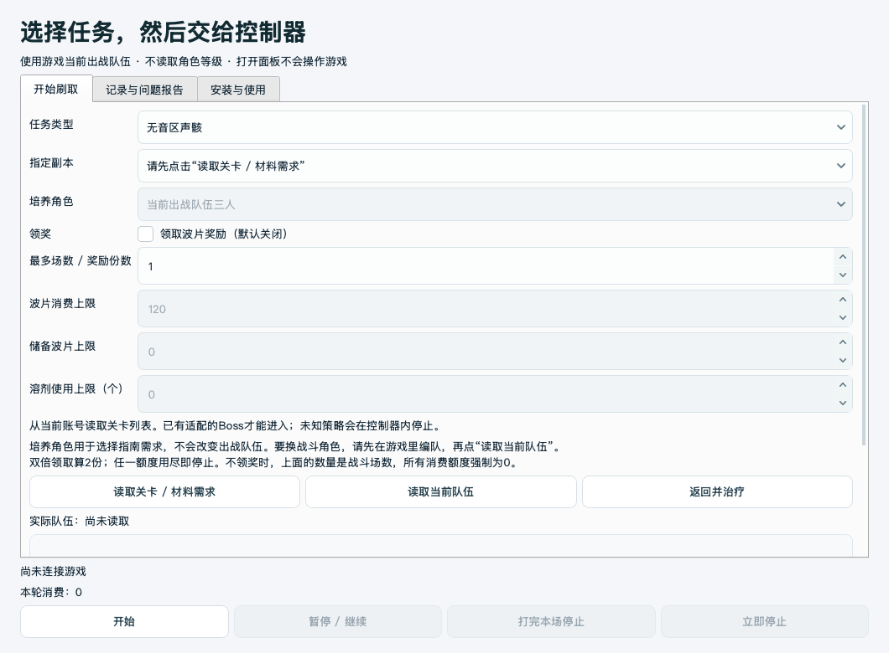

# OK-WW macOS 内测版

[English](README_en.md) · [安装与使用](docs/beta-user-guide.md) · [修复记录](docs/release-0.1.0-beta.2.md) · [问题反馈](https://github.com/Junsheng-He-Life/ok-wuthering-waves/issues)

**0.1.0-beta.2**：独立GUI选择副本、培养角色和消费额度，再由本地控制器执行。不需要Codex，不自动上传日志。

从 [Release](https://github.com/Junsheng-He-Life/ok-wuthering-waves/releases/tag/v0.1.0-beta.2) 下载完整附件 **ok-ww-macos-beta-0.1.0-beta.2.zip**。不要只下载自动生成的Source code；完整附件包含配套ok-script和固定依赖清单。

1. Apple Silicon Mac、macOS 14+，安装Python **3.13**与Xcode Command Line Tools。
2. 完整解压，双击包根 **安装与检查.command**。首次下载依赖需要网络。
3. 双击 **启动.command**；安装器也会生成 **OK-WW 鸣潮助手.app** 启动器。
4. 首次在“安装与使用”确认全新安装、建立本地账本，检查运行程序的屏幕录制和辅助功能权限。
5. 游戏选好出战队伍，GUI读取队伍和关卡，**从下拉列表选择**。首次关闭领奖测试1场。

这是可安装源码包：安装器创建专用虚拟环境，仍需Python和命令行工具；.app是启动器，不是自带Python、签名或公证的独立二进制。移动目录后重新运行安装入口生成启动器。Windows请使用[上游版本](https://github.com/ok-oldking/ok-wuthering-waves/releases)。

| 任务 | 如何选择 |
| --- | --- |
| 无音区 / Boss | 读取列表，从下拉框选择副本 |
| 指定材料副本 | 选择副本和一名培养角色；战斗用当前队伍 |
| 按角色培养需求 | 选择当前三人、指定一人或三人，现场读取缺口 |
| 资源限制 | 场数/份数、波片、储备、溶剂；双倍领奖算2份，任一额度用完即停 |

默认**不领奖、不补给**。关闭领奖强制消费额度为0。培养需求计划需要领奖；只测试战斗请选择指定副本。培养角色不会自动改变出战编队。

支持暂停/继续、立即停止、打完本场停止。暂停只停输入，不暂停游戏敌人。关闭面板会先停止控制器、释放按键并保留消费保护。

报错后在“记录与问题报告”选中失败运行，导出**脱敏诊断ZIP**，打开GitHub表单手动附上。包括版本、依赖、任务、错误栈、消费状态与脱敏日志尾部，默认不含截图、完整日志或账号配置。额外截图先遮住UID和账号名。不要删除保护文件解锁或重复领奖，详见[教程](docs/beta-user-guide.md)。

本版修复材料本进场确认、进场菜单恢复、莫宁空中形态误触发重锁、未确认E重复请求，并补齐GUI、安装和报告流程。经过离线回归与界面检查，**修复后尚未重新实机验收**。1080p是主要实测画面；周本、部分Boss、地区同名入口、野外聚落和多机器仍有未验收范围，不表示所有角色/关卡稳定。

项目含AI辅助开发代码，请先零消费测试并保留反馈。上游关系和许可证见[UPSTREAM.md](UPSTREAM.md)，原始许可证随源码保留。
