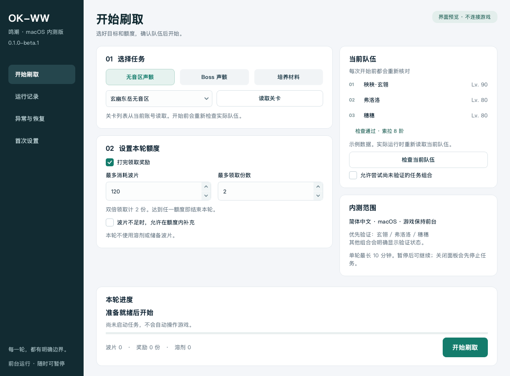
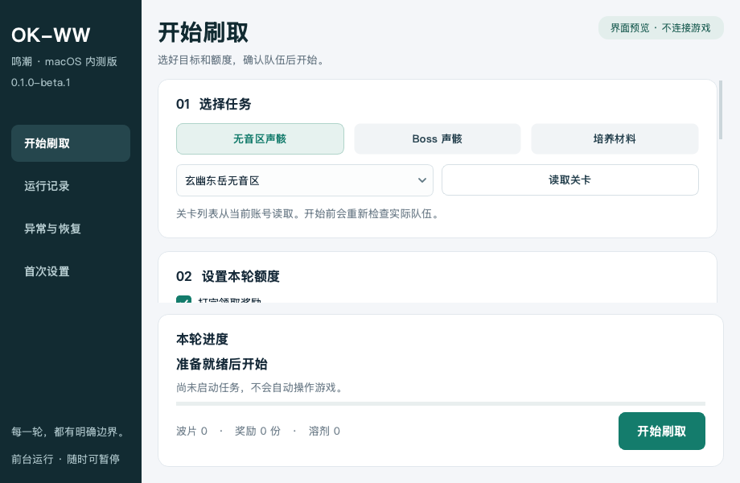

# OK-WW macOS

**An unofficial macOS derivative of [ok-oldking/ok-wuthering-waves (OK-WW)](https://github.com/ok-oldking/ok-wuthering-waves).** This project provides an Echo and cultivation-material farming panel for the native Wuthering Waves client. It is not an official macOS release by the upstream authors or the game developer.

The companion framework, [Junsheng-He-Life/ok-script](https://github.com/Junsheng-He-Life/ok-script), adapts [ok-oldking/ok-script](https://github.com/ok-oldking/ok-script) for macOS. Both projects retain their original AGPL-3.0 licenses and upstream attribution; see [LICENSE.txt](LICENSE.txt) and [upstream credits](UPSTREAM.md).

[中文](README.md) · [User guide, in Chinese](docs/beta-user-guide.md) · [Development](docs/development.md) · [Report an issue](https://github.com/Junsheng-He-Life/ok-wuthering-waves/issues)

## Download and start

Current version: **0.1.0-beta.1, an installable source beta**. Installation in an independent dependency environment and offline regression checks have passed. Validation on multiple physical Macs is still pending.

**[Download v0.1.0-beta.1](https://github.com/Junsheng-He-Life/ok-wuthering-waves/releases/tag/v0.1.0-beta.1)** and select the asset **`ok-ww-macos-beta-0.1.0-beta.1.zip`**. It contains both matching projects, installation commands and pinned dependencies. GitHub's automatically generated `Source code` archives do not contain the complete companion environment.

1. Use an Apple Silicon Mac running macOS 14 or later. Install Python **3.13** and Xcode Command Line Tools, and install the native Wuthering Waves client.
2. Extract the full release asset. Keep `ok-wuthering-waves` and `ok-script` together inside the extracted folder.
3. Double-click **`安装与检查.command`** at the bundle root. It creates a dedicated environment and downloads the pinned dependencies.
4. Double-click **`启动.command`**. Open “首次设置” to check permissions and explicitly create a new local resource ledger, if this is genuinely a first installation without prior history.
5. Use the game's **Simplified Chinese UI and default key bindings**. Read the available stages, check the current party, set a small allowance and begin a supervised trial. Input requires the game to remain in the foreground.

For prerequisites, install Python 3.13 from [python.org](https://www.python.org/downloads/macos/), or use `brew install python@3.13` if Homebrew is already installed. Install Command Line Tools with:

```sh
xcode-select --install
```

The [complete guide](docs/beta-user-guide.md) explains system permissions, resource accounting, recovery, upgrades and troubleshooting. Codex is not required. This beta is not a signed or notarized `.app` / `.dmg`, and does not bundle Python. Windows users should use the [upstream OK-WW release](https://github.com/ok-oldking/ok-wuthering-waves/releases).

## Interface

The start page brings together the task, resource allowances and current party. Separate pages cover run history, recovery and first-time setup. These previews use example data rather than a real account.



Narrow windows switch to a single column. Page content scrolls while start, pause and stop controls remain visible.



## What this beta provides

- **Fresh party checks:** identity, level, HP and SOL3 Phase are reread before each run. Party changes and slot changes do not reuse the previous lineup. Material requests follow freshly read cultivation targets for the current three characters.
- **Task selection:** Tacet Field Echoes, Boss Echoes and cultivation materials, plus an Echo absorption-only mode. Execution remains subject to recognition, available strategies and beta eligibility checks.
- **Explicit allowances:** separate limits for Waveplates, reward units, Crystal Solvents and reserve Waveplates. Refills start disabled, with zero solvent and reserve allowance. There is no unlimited-run control.
- **Persistent accounting:** genuine new installations explicitly create their own ledger. Existing history, damaged records and unresolved spending cannot be reset through initialization. Supported interrupted Echo claims can be reconciled from sufficient evidence without claiming again or recording the same expense twice.
- **macOS capture and input:** ScreenCaptureKit capture, foreground native input and Retina pixel-to-point conversion. Changes to the game window's geometry stop new input while allowing held keys to be released.

## Validation and limits

| Area | Current scope |
| --- | --- |
| Installation | Apple Silicon, macOS 14+, Python 3.13, Xcode Command Line Tools; the OS minimum comes from dependency requirements |
| Game | Native client, Simplified Chinese, default bindings, foreground input |
| Priority beta combination | SOL3 Phase 8, 玄幽东岳无音区, 秧秧·玄翎 / 弗洛洛 / 穗穗; party slots may be rearranged |
| Party gate | All three characters at level 80 or above and at least 85% HP, with confirmed identities and world level; equipment and skill investment are not automatically verified |
| Panel | Minimum 920 × 600 logical pixels; several window sizes and 1×, 1.5× and 2× scaling checked offscreen |
| Game capture | Configured for 16:9, 16:10 and 43:18, with a minimum capture of 1280 × 720; individual setups still need validation |
| Public tests | [Published offline subset](docs/development.md): 112 application and 49 framework checks passed; reproducible from the matching source tags |
| Software checks | **620 regression tests passed** in a fresh dependency environment; **49 macOS backend and startup-error tests passed**; Swift type checking passed |

Installation and regression validation used one physical Mac. **Another Mac, a new account, the complete new-panel gameplay flow, real pause/interruption recovery, display switching during play and consecutive runs with multiple parties still require live acceptance testing.** Offline checks do not establish stable support for every character, stage, display or macOS version.

Other party or stage combinations require an explicit experimental option. It does not bypass identity, level, HP, strategy or spending protections. See the [user guide](docs/beta-user-guide.md) for the precise workflow.

## Feedback, credits and license

Stop the current run, export a diagnostic package from “异常与恢复”, and open an [issue](https://github.com/Junsheng-He-Life/ok-wuthering-waves/issues). Include the version, Mac and macOS details, task, party and reproduction steps. The export excludes raw game screenshots, complete logs and account configuration. Redact UID and account information from any screenshots you add separately.

| Project | Repository |
| --- | --- |
| Original OK-WW | [ok-oldking/ok-wuthering-waves](https://github.com/ok-oldking/ok-wuthering-waves) |
| This macOS derivative | [Junsheng-He-Life/ok-wuthering-waves](https://github.com/Junsheng-He-Life/ok-wuthering-waves) |
| Original OK-Script framework | [ok-oldking/ok-script](https://github.com/ok-oldking/ok-script) |
| Companion macOS framework | [Junsheng-He-Life/ok-script](https://github.com/Junsheng-He-Life/ok-script) |

Thanks to the upstream authors and contributors for the task, recognition and automation foundations. The original [AGPL-3.0 license](LICENSE.txt) is retained; redistribution, modifications and service use must comply with the applicable license. See the [development guide](docs/development.md) for maintenance and contributions.

This project uses screen recognition and simulated input. Third-party automation may carry game-account risks; understand and follow the game's rules. The software is provided “as is” under its license.
